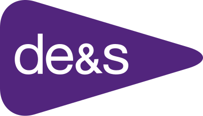

<!-- PROJECT LOGO -->
<br />
<div align="center">
  <a href="https://github.com/desdigital/https://github.com/desdigital/des-aai-llm-dx4d">
   <p>
      
   </p>
  </a>
<h3 align="center">IRiS: AI-Enhanced PQ and Correspondence Process</h3>
</div>

## Tool Modes

| Mode | Tech Stack | Core Logic |
|------|------------|------------|
| Related Responses | Azure OpenAI On Your Data | `app.py` + `backend/prompts` |
| Policy & Guidance | Azure OpenAI On Your Data | `app.py` + `backend/prompts` |
| Evaluate Draft | Azure OpenAI On Your Data | `app.py` + `backend/prompts` |
| Ask Anything | Azure OpenAI On Your Data | `app.py` + `backend/prompts` |
| Information Annex (MP Profile) | LangGraph + Azure OpenAI + Azure Search | `backend/annex` |
| Metadata Search | Azure Search | `backend/metadata_returner` |

## Architecture

### Backend
- **Framework**: Quart
- **LLM**: Azure OpenAI for embeddings and completions
- **Search**: Azure Cognitive Search for vector similarity and hybrid search
- **Storage**: Azure Blob Storage for documents, Cosmos DB for history, Azure Table Storage for user management
- **Cache**: Redis for session storage and caching

### Frontend
- **Framework**: React 18 with TypeScript
- **Build Tool**: Vite

## Structure

```
├── .deployment_settings/ # Deployment configuration for different environments
├── .devenv/             # Local Identity Server for development authentication
├── .github/             # GitHub Actions workflows and CI/CD
├── .vscode/             # VS Code workspace settings and debug configs
├── backend/             # Python backend application
├── ops/                 # Document processing pipelines for RAG maintenance
├── frontend/            # React frontend application
├── scripts/             # Utility scripts
├── docs/                # E.g. architecture diagrams
└── static/              # Static assets and compiled frontend
```

## Getting Started

### Prerequisites

- Python 3.11
- Node.js 18+

### 1. Environment Setup

Create a copy of `.env.example` file in the project root and rename to `.env`. Fill in variables.

### 2. Quick Start

**Windows:**
```shell
# Development mode - frontend dev server on http://localhost:5173, backend on http://localhost:50505
start-dev.cmd

# Production mode - backend on http://localhost:50505 serves pre-built frontend
start.cmd
```

**Linux/Mac:**
```bash
# Development mode - frontend dev server on http://localhost:5173, backend on http://localhost:50505
./start.sh
```

> [!NOTE]
> If you are using the `uv` package manager, you can pass `uv` as an argument to any of the start scripts (e.g., `start.cmd uv` or `./start.sh uv`).

> [!IMPORTANT]
> If you want to run with `AUTH_ENABLED`=`true`, see the `readme.md` in `.devenv/`.

## Development

### Debugging

1. Ensure `.env` exists in repo root (with `APP_ENV=local`).
2. In VS Code Run and Debug, start `Python: App Backend`.
3. In a terminal: `cd frontend` then `npm run dev`.
4. In Run and Debug, start `Frontend: Vite (Chrome)` which will launch Chrome with the debugger attached.

### Formatting
Backend: use `black` (see requirements-dev.txt)

```shell
cd backend && python -m black .
```

Frontend: use `prettier`

```shell
cd frontend && npm run format
```

### Linter
Frontend: use `ESLint`

```shell
cd frontend && npm run lint
```

### Tests

Backend:

```shell
python -m pytest tests
```

Frontend (e2e):

```shell
start-dev.cmd uv
```

```shell
cd frontend && npm test:e2e
```

Frontend (unit):

```shell
cd frontend && npm test
```


## Deployment

The application is deployed as an Azure Web App using containerised deployment. The deployment process is automated through GitHub Actions:

1. **Container Build**: When code is pushed to the `main` or `development`, the respective workflow builds a Docker image using `WebApp.Dockerfile`. Feature packages can be manually triggered against a specified branch via GitHub Actions.
2. **Container Registry**: Built images are pushed to GitHub Container Registry (ghcr.io) with versioning tags
3. **Azure Deployment**: The Azure Web App pulls and runs the container image

You can also trigger `.github/workflows/deploy.yml` via GitHub Actions, to manually deploy a specific container image tag to a selected environment in Azure directly. (Note: The commit hash and package version are not specified in the `.deployment_settings` JSON files and so would still need to be manually configured.)

## Configuration

Some important variables to be mindful of:

* `AUTH_ENABLED`: `True` to enable authentication. If `True`, will require startin a local instance of Identify Server; refer to instructions in `.devenv/readme.md`.
* `APP_ENV`: Set to `local` if running locally
* `AUTH_CLIENT_SECRET`: If running locally, set to any string -- just do not leave blank.
* `DEBUG`: Set to `True` for DEBUG level, else `False` defaults to INFO level.
* `UI_APP_PACKAGE_VERSION` and `UI_APP_COMMIT_HASH`: Able to be left blank in development. These display in the frontend, bottom-right of the page.

> [!NOTE]
> `AZURE_SEARCH_SCORE_THRESHOLD_ANNEX`=`2.0`. Value given by Primary Stakeholder.
>
> `AZURE_SEARCH_SCORE_THRESHOLD_FIND_ALL`=`1.8`. Value given by Primary Stakeholder.
>
> `top_k` and `strictness` values given in `search_config` of `app.py` are hardcoded for version control. `strictness` is set to `1` to ensure all `top_k` chunks are passed to the LLM. 